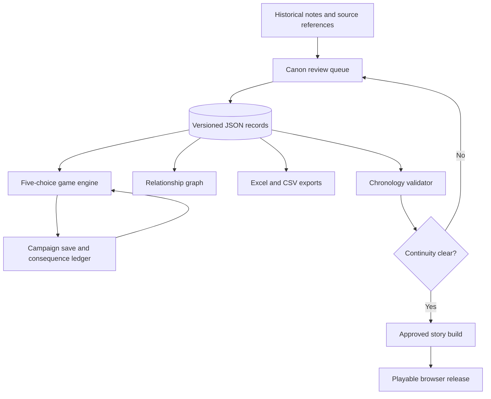

# Campaign architecture

## Core folders
- `data/`: canonical record schemas and approved entities.
- `docs/`: editorial rules, source notes and diagrams.
- `game/`: player interface and game engine.
- `scripts/`: import, export, simulations and validators.
- `tests/`: deterministic regression cases.
- `assets/`: approved art, maps and icons (planned).
- `stories/`: versioned narrative drafts (planned; do not upload private manuscripts without approval).

## Record relationship rules
All entities get stable IDs. Each relationship stores subject, predicate, object, source, effective DR date range, plane, confidence and canon/homebrew flag. Unknown values remain unknown. Historical DR timestamps must never be silently replaced by gameplay timestamps.

## Diagram legend
BLUE hero; RED villain; GREEN neutral; PURPLE arcane; GOLD divine. These are editorial roles, not official D&D alignments.
